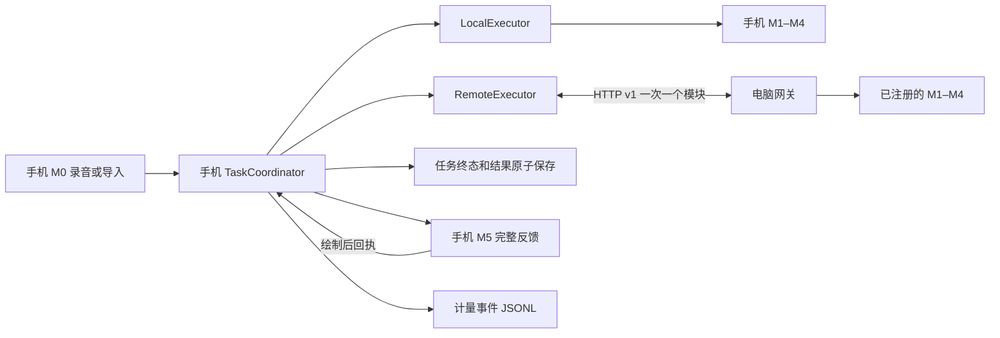

# S0–S3 端云执行结构

M0 和 M5 始终在手机。中间四个节点由任务创建时的不可变计划确定执行端。全远程表示 M1–M4 在电脑执行，响应每次回手机。混合样例将 M2 和 M3 放在电脑，M2 的正文先回手机，手机再组装下一份请求提交 M3。设备在应用层保持单在途，网关进程按去重键处理重发。模型仍在运行的取消或超时任务不能写入成功终态。

任务正常经 CREATED、RUNNING 到 SUCCEEDED。取消、失败和重启中断分别进入终态。协调器是结果写入点，成功记录与反馈一次替换。界面绘制完成后按当前 task_id/attempt 写展示回执。事件记录用 ID、版本、状态、时长与字节，原始转写和反馈保存在私有任务文件。

S2 计量支撑课程 Part A 的性能与两机单机基线。S3 的单模块路由及中转计量是 Part B 的通信采样入口。课程 Part B 的最优切分、多因素实测和 Part C 的运行时策略分别在后续阶段验收。
