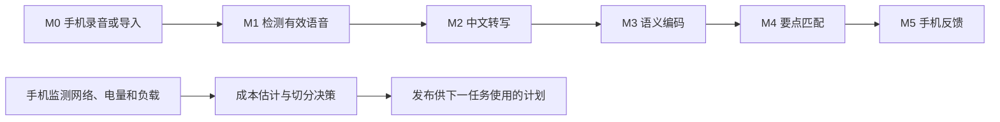
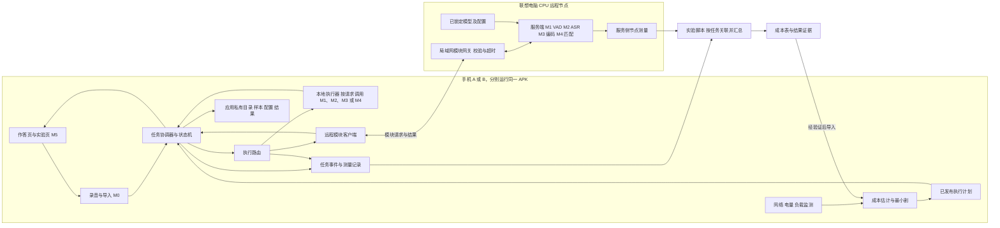

# 语音回答语义分析与反馈系统三人分工实施计划

**业务场景：公务员考试模拟面试平台｜本组子系统：考生端语音作答分析与反馈**

## 1. 起点与目标

三人先接通一条可在手机断网运行的语音回答链路，再用同一套模块做静态切分和自动重切分。阶段按可验证成果推进，不排具体日期。任务书决定 A/B/C 交付和评分范围；最新选题报告决定六环节、分工与设备；RUP SAD V0.1 是接口和架构设计起点；共享聊天用于核对选型和实际开发路径。早期纯文本、手势以及整套面试网站的方案不沿用。V0.1 已有设计制品，本次没有运行原型或验收性能的证据。

平台业务流程是考生进入模拟面试、选择题目、语音作答并查看反馈。本组交付其中可独立运行的考生端语音分析与反馈子系统。平台侧提供题目和参考要点，子系统处理录音并返回转写、要点覆盖、匹配原句与可能遗漏项。首版由 Android 原型内置题目和参考要点，展示一次完整模拟面试练习。任务书的多人房间、视频和评分管理属于平台背景。

贯穿用例采用“如何组织社区反诈宣传”。考生在作答页选题并录音。实验从实验入口导入同一份固定录音，控制网络条件并导出记录。Part A/B/C 的测量范围是这条语音链路及其计算切分与运行时调整。

| 任务书目标 | 阶段与任务包 | 可交成果 |
| --- | --- | --- |
| A：完整应用、多输入单机基线、量化指标 | S0 准备 → S1 离线链路 → S2 单机基线 | 可运行 Android 源码、两台手机基线与结果质量记录 |
| B：模块结构、可复算成本、三配置、多因素与权衡 | S3 两端契约 → S4 静态切分与实验 | 带成本 DAG、成本原表、16种归属核验、三配置结果和权衡矩阵 |
| C：动态系统、视图、架构决策与稳定性 | S5 自动决策和恢复 | 可运行动态模式、切换与故障日志、C&C、部署图及 ADR |
| 报告与演示 | S6 交叉复现与交付 | 源码、架构文档、最终报告、PPT、演示清单与录屏 |

## 2. 主责与交接

| 成员 | 负责到底 | 需要交给谁 | 反向复核 |
| --- | --- | --- | --- |
| 刘慧芳（202430550936） | Android 构建、M0 录音/导入、M1 VAD、M5 展示、手机状态监测与计划应用、双机验收和部署材料 | 向彭交标准音频、片段与时间戳；向林交 Android 调用端、监测事件、手机日志和部署图 | 复核林的计划在手机实际生效；复测模型适配的 UI 错误分支 |
| 彭雯青（202430552622） | M2 中文转写、M3 语义编码、M4 匹配，模型清单、样本、跨端一致性、统计脚本与实验结果章节 | 向刘交可离线运行的模块；向林交两端模型配置、金样例、CER 与匹配差异、各节点执行测量 | 用同一输入复核服务响应与模型版本；查明错误来自 VAD、转写还是匹配 |
| 林俊希（202430550897） | 局域网网关、模块协议、执行路由、成本模型、最小割和动态决策 | 向刘交协议、执行计划和错误码，向彭交服务启动方式、成本表与计划日志 | 复跑一条端到端链路，核对实际执行端和决策记录 |

三人各有可独立验收的代码和证据。刘与彭共同负责全本地闭环，彭与林共同负责模型与服务一致性，刘与林共同负责计划应用和回退。每个工作包的复核人须亲自按说明操作并记录版本与结果。

### 2.1 决策权和合并责任

| 角色 | 日常决定 | 必须拉谁一起评审 |
| --- | --- | --- |
| 刘慧芳，Android 客户端负责人 | 录音、导入、界面状态、手机权限和资源生命周期、M1 分段规则、手机状态采样 | 音频和片段格式请彭确认。计划应用、取消及回退请林确认 |
| 彭雯青，语音与语义算法负责人 | M2—M4 的两端适配、模型和阈值版本、样本、有效性评估、实验统计与结果图表 | M1→M2 请刘确认。改变模块输入输出、模型加载成本或服务器运行方式请林确认 |
| 林俊希，端云执行与切分负责人 | 网关、共用协议维护、执行路由、成本模型、最小割和动态策略 | 涉及手机调用的改动由刘复核。涉及模型字段、算法行为或实验可比性的改动由彭复核 |

三人按技术责任区平等协作。刘维护 Android 构建入口、应用组装与设备验证。彭维护两端算法、模型清单、样本标签、统计脚本和结果图表。林维护网关、路由、共享协议和切分实现。代码由对应负责人维护，跨模块改动须由提供方与调用方一起复跑相关用例，再合入主线。协议文件由林维护，协议变更由受影响的两侧共同确认。

阶段验收由当前最接近交付物的人收集证据。S0 和 S1 由刘整理构建与离线记录，S2 由彭整理双机基线，S3 和 S4 由林整理协议与切分证据，S5 由刘整理真机回退轨迹，S6 由彭收齐复现记录与交付清单。记录人负责收证据和跟踪缺项，各模块的通过状态由实现者和独立复跑人共同确认。

## 3. 目标架构与开发边界



M0、M5 固定手机；M1—M4 各自可本地或远程。实际执行由同一任务协调器根据计划选本地执行器或局域网网关。小米14和荣耀200分别连接同一台联想21LD（Core Ultra 5 125H、约32 GB、Windows 11）；电脑是远程执行节点，两台手机才是设备对照。省电模式只做状态因素。优先 CPU，手机性能差异以实测为准。

| 模块及责任人 | 开发过程 | 输入 → 输出 | 验证与异常 |
| --- | --- | --- | --- |
| M0 刘 | 整理录音读帧、权限生命周期与文件读取逻辑，统一录音和导入路径 | 录音或文件 → 16 kHz、单声道、16 bit PCM/WAV 与任务元数据 | 拒绝麦克风权限可导入；损坏或超限输入明确拒绝 |
| M1 刘，林做服务封装 | 将 Silero VAD ONNX 推理封装成单次任务调用；按固定阈值合并片段，保留原始起止时间，每次回答重置检测状态 | 音频 → 片段和原始时间映射 | 纯静音返回 NO_SPEECH；有噪语音检查截头截尾和两端边界 |
| M2 彭 | 封装 Vosk 中文模型初始化、PCM 分块送入、最终结果提取与片段回拼；将识别器生命周期与 UI 解耦 | 语音片段 → 中文转写、时间映射 | 模型缺失明确报错；人工转写对照，计算中文字符错误率 CER |
| M3 彭 | 按同一 tokenizer 分词并控制长度，使用 ONNX Runtime 在两端推理；确认导出图是否已做池化，需外置时按掩码求均值，再按约定归一化 | 转写分句和参考要点 → 句向量、原句索引 | 候选 MiniLM 384 维、128 token 口径，最终以锁定文件为准；用长输入和金样例查截断、维度与数值 |
| M4 彭 | 每个参考要点与各回答句算余弦相似度，记录最佳证据句及分数，按冻结规则给出覆盖与遗漏提示 | 向量、句子索引、阈值 → 逐要点结果 | 缺失、离题、否定与阈值邻近样本人工复核；零向量或异常维度不冒充匹配 |
| M5 刘 | 显示转写、证据句、遗漏项和模板提示；实验入口另显示实际执行端、计划版本、耗时和流量 | 分析结果、状态 → 页面和可导出实验记录 | 按任务编号只采纳一次，取消后忽略迟到结果 |

实际开发先验证已有录音、离线识别和模型调用方式，再封装为以上模块；本组主要新增公务员题目及要点规则、统一契约、手机和电脑两端适配、计量、切分决策与故障恢复。代码来源、固定提交、许可证与必要署名随源代码管理；引用不等于已运行，复用部分不得记为小组原创。模型、模型资源和运行时分别登记版本与哈希。Python 服务及实验脚本在项目专用 Conda 环境下运行（本机 D:/miniconda3/envs/software_architecture），Android 按 Gradle/JDK/SDK 锁定配置构建。

### 3.1 OfflineVoiceAssistant 源码迁移作业单（组内实施）

本节按这次要求补充直接复用的路径。先把上游源码作为只读对照，在本组 Android 工程里选择性移植录音和 Vosk 部件。目标文件名是拟定名称。已核对上游服务源码中的调用关系。表内涉及独立文件内部实现的条目，须在克隆后以锁定提交为准复查。当前未编译上游工程或在手机上验证。

#### 3.1.1 取得源码并锁定基线

林俊希在能访问 GitHub 的环境下，从项目工作区运行。把原始克隆留在组内证据目录，应用代码提交到小组仓库。第二次运行时复用已存在的克隆目录，从组内记录取得同一个完整 SHA。

```powershell
$ovaSrc = Join-Path $PWD '.evidence/upstream/OfflineVoiceAssistant'
New-Item -ItemType Directory -Force (Split-Path -Parent $ovaSrc) | Out-Null
git clone https://github.com/brain-marchine/OfflineVoiceAssistant.git $ovaSrc
git -C $ovaSrc rev-parse HEAD
git -C $ovaSrc ls-tree -r --name-only HEAD
rg -n 'AudioRecord|audioCapture\.start|createRecognizer|parseResult|installFromUri|acceptWaveForm|finalResult|handleRecognizedText|vosk|okhttp' (Join-Path $ovaSrc 'app')
```

登记实际 SHA、源码相对路径、迁入路径、原样复制或改动、验证人和模型版本。搬代码时随之保留原许可证及版权声明。先读上游 Gradle、wrapper properties、Manifest，核对 Vosk 坐标与 ABI。构建脚本齐全时才运行其 wrapper。若缺入口脚本或 wrapper 文件，在 Android Studio 导入核对后使用匹配的 Gradle 版本。正式工程的 Gradle 配置仅迁入实际依赖和必要 ABI 设置。模型 ZIP 单独准备，记录来源、许可证、哈希和大小。上游文档采用 cn-0.22，本组先按两台手机内存和同一录音的结果决定是否锁定该版本或更轻的中文版本。两端必须使用同一已锁定模型。  
[上游仓库与构建说明](https://github.com/brain-marchine/OfflineVoiceAssistant) · [上游许可证](https://github.com/brain-marchine/OfflineVoiceAssistant/blob/main/LICENSE)

#### 3.1.2 从哪个文件搬到哪个模块

下表的上游相对路径以 `app/src/main/java/com/offline/voiceassistant/` 为前缀。小组的 Kotlin 源码放在 `mobile/app/src/main/java/<本组包名>/` 下。文件搬过去后逐个核对 import、资源引用和依赖，避免为解决一个编译错误把整个语音助手服务一起迁入。

| 负责人 | 上游定位 | 搬运与改造 | 小组目标 |
| --- | --- | --- | --- |
| 刘慧芳 | `speech/AudioCaptureEngine.kt`，由 `VoiceAssistantService.startListeningInternal()` 调用 | 在锁定版本中定位 AudioRecord 初始化、读缓冲、停止及释放。抽取能独立采集的部分，将识别器参数和识别回调换成 PCM 块输出。首版统一手机内置麦克风，使用同一录音配置，交给 M1 前不做会改变样本的命令过滤 | `capture/InterviewAudioRecorder.kt`，M0 |
| 刘慧芳 | `VoiceAssistantService.kt` 的权限和状态回调，`stopListening()` 的停止顺序 | 参考麦克风权限检查和监听状态通知。页面改为开始、停止、导入、取消。停止后等待读循环退出并完成文件落盘，再提交一次任务。另写 WAV 文件头与导入校验 | `ui/InterviewScreen.kt`、`capture/WavPcmIO.kt` |
| 彭雯青 | `speech/VoskSpeechEngine.kt` 和 `speech/VoskModelInstaller.kt`，服务中已见 `ensureModel`、`createRecognizer`、`parseResult`、`installFromUri` 调用 | 优先复制模型初始化及结果解析中与助手无关的函数。若文件依赖模型路径、URI 设置或资源字符串，只迁必要函数或用组内路径和本地资源替换。将识别器创建和关闭放在 M2，输入改为 M1 的片段 | `analysis/asr/VoskModelProvider.kt`、`analysis/asr/VoskAsrModule.kt` |
| 彭雯青 | `VoiceAssistantService.kt` 中 `AudioCaptureEngine.Listener.onFinalText` 到 `handleRecognizedText` 的边界 | 保留结构化解析所得转写，结束时输出本组 Transcript。切掉后续唤醒词、结束词、声纹、系统命令和 TTS。默认记录置信信息，任何会删除回答内容的规则须单独验证 | `contracts/` 的 Transcript 定义及 M2 测试 |
| 刘慧芳与林俊希 | 上游服务将 `SpeechCaptureConfig` 交给录音引擎，另外有声纹模块 | M1 单独封装 Silero VAD，将确定的输入帧、阈值与合并规则写成两端一致的配置。用公开实现的 ONNX 推理和时间段提取方式，产出原始时间轴上的片段 | 手机 `analysis/vad/SileroVadModule.kt`、电脑 `server/modules/vad.py` |
| 彭雯青 | M3/M4 使用已选句向量工具链的模型和推理示例 | 参考 tokenizer、池化、相似度逻辑，手机端按 ONNX Runtime 的 API 实现同一预后处理。用实际导出图确认池化位置，再实现逐要点匹配和证据句返回 | 手机 `analysis/semantic/`、电脑 `server/modules/semantic.py` 与 `match.py` |
| 林俊希 | `VoiceAssistantService.ensureInitialized()` 创建 `RemoteOllamaEngine` 和 `HybridLlmEngine` | 只参考地址配置与本地、远程调用的分层。写独立模块 HTTP 请求，按 M1—M4 的执行计划选端。服务端实现相同模块契约。计时、最小割、重切分与回退由本组实现 | `RemoteModuleClient.kt`、`ExecutionRouter.kt`、`server/`、`planner/` |

[已核对的服务源码](https://github.com/brain-marchine/OfflineVoiceAssistant/blob/main/app/src/main/java/com/offline/voiceassistant/VoiceAssistantService.kt) · [Silero VAD 实现](https://github.com/snakers4/silero-vad) · [Sentence Transformers 实现](https://github.com/huggingface/sentence-transformers)

#### 3.1.3 三次代码交接的具体操作

1. **刘先交一份可独立读写的语音文件。** 原调用把麦克风和识别器绑在一起。把读出的有效样本按读取返回值写入缓冲或文件，16 bit 样本按实际 PCM 小端格式输出，WAV 头与音频长度匹配。停止时先阻止新读取并等待写入收尾，取消时清理未完成的临时文件。先用约10秒固定样本验证 16 kHz、单声道、16 bit WAV，纯 PCM 载荷约320 KB。录两次确认没有复用旧缓冲。把 WAV、哈希、采样参数和时长交彭。M1 输出 `startSample/endSample` 及对应片段，偏移以原音频为基准。
2. **彭在无麦克风的情况下跑 M2。** 先让固定片段文件直接进入识别函数。模型可在已选预热策略下复用，识别器按片段新建并释放。把 WAV 头解掉，只把 PCM 样本按锁定 Vosk API 分块送入。保留分块过程中提交的已完成结果，再收尾读最终结果，忽略临时文本，避免漏字或重复拼接。片段内时间戳加原始偏移。用两片段样本检查最后一段没有丢失，再测连续两个回答不会串结果。把转写 JSON、错误码和版本清单交刘与林。
3. **林接同一录音完成跨端验证。** 建议先做手机调用电脑 M2 的单模块请求。请求含 task_id、attempt、plan_version、音频格式、片段偏移和模型版本。电脑回转写、实际执行端及节点耗时。用同一份 PCM 对比手机 M2 与电脑 M2。通过后才扩到 M1、M3、M4，然后按原 S4/S5 接切分和动态决策。服务拒绝坏格式、超限负载和版本不符。取消、超时及迟到结果按任务状态处理。

实际调用链由本组重新接线。旧链路按连续聆听的最终识别事件调用助手逻辑。新链路在停止录音或提交导入文件后建立一次任务，依次执行 M1、M2、M3 和 M4，再由 M5 展示。首个合并请求只接录音与 WAV，第二个接固定输入转写，第三个接端侧整链。每次合并附一份可复跑输入、版本、期望输出和实际日志，迁移失败可回到上一可运行提交。

| 合并检查 | 主责与复核 | 通过标准 |
| --- | --- | --- |
| 录音代码可用 | 刘主责，彭复核 | 两手机都能从页面录音，导出 WAV 可被独立解码；拒绝权限能导入，取消后不提交 |
| ASR 代码独立 | 彭主责，刘复核 | 断网运行固定录音，两片段有顺序和时间偏移；连续任务隔离，缺模型有明确状态 |
| 本地语音闭环 | 刘、彭联调，林复核 | 两台手机飞行模式录音或导入，日志证明 M0—M5 在手机执行，并显示转写和要点证据 |
| 远程模块可替换 | 林主责，彭复核 | 相同固定输入分别从本地与电脑执行 M2，版本和输出可对照；超时及重复响应可复现 |
| 复用出处可追溯 | 林汇总，刘、彭确认各自文件 | 组内记录可从目标文件定位至上游提交和路径，原许可证及声明齐备 |

### 3.2 完整系统架构与部署

下图展开考公模拟面试平台中由本组实现的考生端子系统。业务入口是模拟面试作答页，业务出口是考生反馈页。电脑节点为子系统提供远程计算，供同一条业务链路切换执行位置。



- **业务路径。** 用户停止录音，M0 交出音频和题目。协调器给任务分配编号，并冻结计划版本。路由器逐模块调用手机或电脑执行器。模块返回后先校验结果和版本，再把中间产物交给下一模块，最后由 M5 显示。全本地关闭网络也能跑完。
- **控制路径。** 监测器把网络、电量和负载变化交给决策器。决策器查成本表，按策略判定是否发布新计划。新任务才取新计划。超时回退是当前任务内单独记录的一次尝试，遵守原预算与最终结果采纳规则。
- **测量路径。** 每次模块执行记录 task_id、attempt、模块、实际执行端和成本。手机的端到端日志与服务日志按标识关联。实验脚本输出统计与可复算成本表。彭核对样本和统计口径，刘抽查双机日志，林检查成本字段后导入决策器。
- **跨端执行约定。** 首版选用手机中转，由手机保管中间产物并逐模块调用。连续两个远程节点之间也经过一次回传和一次重新上传，按第4.4节计入成本。S3 联调冻结此口径，S4 用同一策略比较预测和实测。

### 3.3 共用代码仓库目录

建议采用一个仓库。目录与文件名是实施约定，在 S0 建立骨架。Android 工程根在 `mobile/`，其中 `<本组包名>` 按 Android 的包路径展开。Python 服务与实验脚本共用项目专用 Conda 环境。括号标明合并责任人。

```text
项目根目录/
├── README.md、.gitignore                 （三人分别维护各自启动说明，阶段记录人合并索引）
├── LICENSE、THIRD_PARTY_NOTICES.md        （林，刘和彭提供各自迁移记录）
├── environment.yml                      （林，服务和实验依赖）
├── mobile/                              （刘，Android 工程与 APK 构建）
│   ├── settings.gradle.kts、build.gradle.kts、gradle/
│   └── app/
│       ├── build.gradle.kts
│       └── src/
│           ├── main/
│           │   ├── AndroidManifest.xml、res/
│           │   └── java/<本组包名>/
│           │       ├── ui/                （刘，作答、反馈与实验页）
│           │       ├── capture/           （刘，录音、导入、WAV）
│           │       ├── analysis/vad/      （刘，M1）
│           │       ├── analysis/asr/      （彭，M2）
│           │       ├── analysis/semantic/ （彭，M3 与 M4）
│           │       ├── monitor/            （刘，手机状态采样）
│           │       ├── application/        （林，任务协调、路由、计划与回退）
│           │       ├── transport/          （林，远程模块客户端）
│           │       └── storage/            （刘，设备私有存储与导出）
│           ├── test/                       （模块负责人各管同名测试包）
│           └── androidTest/                 （刘，界面与设备联调）
├── server/                               （林，局域网服务和启动入口）
│   ├── app.py、gateway/                   （林，协议校验与调用）
│   ├── modules/
│   │   ├── vad.py                        （刘维护算法，林负责接入）
│   │   └── asr.py、semantic.py、match.py （彭，模型及算法）
│   └── tests/                            （模块负责人各管对应测试）
├── contracts/                            （林，接口版本与兼容性）
│   ├── module-request.schema.json
│   ├── module-result.schema.json
│   ├── execution-plan.schema.json、errors.md
│   └── examples/                         （刘供 WAV/片段，彭供模型期望，林供协议样例）
├── planner/                              （林，电脑端复算脚本和最小割用例）
│   ├── solve_cut.py、verify_16.py
│   └── fixtures/                         （林，含供手机端复跑的成本与期望值）
├── models/manifest.json                  （彭，模型版本、哈希、来源及放置说明）
├── experiments/
│   ├── samples/                         （彭，样本清单、标签与授权记录）
│   ├── configs/                         （林，实验配置。刘确认设备与网络，彭确认样本与统计口径）
│   ├── scripts/                         （彭，统计和图表。林的成本复算在 planner/）
│   └── results/                         （彭，结果汇总。三人各提交原始记录）
└── docs/
    ├── architecture/、adr/              （林管 C&C 与决策，刘管部署图）
    └── demo/                           （刘负责设备操作，林与彭补演示材料）
```

运行时求解和计划发布在 Android 的 `application/`，电脑端 `planner/` 提供复算和对照。两端共用成本样例，检查得到相同目标值和约定的同值处理结果。上文迁移表中的 `RemoteModuleClient.kt` 放在 `transport/`，`ExecutionRouter.kt` 放在 `application/`。模型权重、私人录音、账号与各机器本地 SDK 路径独立存放，仓库保留哈希、授权索引和取用说明。小型授权测试样本可随仓库，用来支撑每人独立联调。

## 4. 共同接口和数据约定

| 交接物 | 拟定入口或位置 | 字段与验收要点 |
| --- | --- | --- |
| 模块协议 | `contracts/`；Android 本地适配器与局域网服务实现同契约 | 请求含 task_id、attempt、module_id、plan_version、schema/model/config 版本、内容类型及截止预算；响应含状态、实际执行端、输出、节点耗时、传输字节。地址、路由和载荷编码在 S0 定义，由 S3 实跑锁定 |
| 题库和固定样本 | `experiments/samples/` | 题目、要点编号、授权录音、人工转写、人工覆盖标签、样本哈希；评估样本不得用于调阈值 |
| 执行计划与状态 | Android 的 `application/`、`contracts/execution-plan.schema.json` | 计划含设备、模型/配置标识、成本表版本和 M0—M5 归属，创建任务时取不可变快照，终态与结果一致保存 |
| 运行测量与配置 | `experiments/configs/`、`experiments/results/` | run_id、sample_id、device_id、执行计划、网络条件、节点/边成本、温度/缓存/预热、结果与错误；正式采集记录可回溯到同一发布版本 |

这些是拟建路径。客户端时间用单调时钟，手机端测完整往返，服务器报其本机耗时，不相减两台机器的时钟。空输入、静音、格式/版本错误、模型失败、远程超时、取消各有可区分状态。手机私有目录保存样本和结果；重启未完任务标记中断，不自动重发；日志默认不导出原始音频及转写全文，服务端仅处理当前任务所需数据。局域网按约定控制访问，禁止任意模块名、文件路径和无限载荷。

### 4.1 技术栈与版本冻结

| 层 | 首版选型 | 谁落地、如何冻结 |
| --- | --- | --- |
| Android | Kotlin、AndroidX ViewModel、XML 布局、Kotlin Coroutines。JDK 17，Gradle Wrapper + Android Gradle Plugin，minSdk 26，arm64-v8a。以两机可构建、可安装为条件选定 compileSdk/targetSdk | 刘维护 `mobile/` 下的构建文件与版本目录。在 S0 锁定 JDK、Gradle、AGP、Kotlin、SDK 和依赖版本。录音用 `AudioRecord`，文件导入用 Android 文件选择器，状态经 ViewModel 发布 |
| Android 网络与保存 | OkHttp、kotlinx.serialization。用应用私有目录保存 WAV 和 JSON 记录，用 JSONL 写实验事件。调试构建仅按实验配置连接受控局域网 | 刘维护存储，林维护传输。记录用临时文件写完再替换，模型和凭据放在构建产物之外 |
| 语音与语义 | M1 Silero VAD ONNX。M2 Vosk Android/Python。M3 多语言 MiniLM ONNX，Android 与 Windows 均先使用 ONNX Runtime CPU。M4 Kotlin/Python 实现相同余弦匹配与模板规则 | 刘锁定 M1。彭在 `models/manifest.json` 锁定 Vosk 模型、ONNX、tokenizer、输入张量、池化与归一化、阈值和哈希。tokenizer 在 Android 必须用金样例核对 token IDs、掩码及截断后再锁定实现 |
| Windows 服务 | Python 3.11 作为 S0 验证基线，FastAPI、Pydantic v2、Uvicorn 单进程、NumPy、Vosk、onnxruntime。模型资源复用，每次识别独立创建识别器 | 林锁定项目专用 Conda 环境与版本文件。彭验证 Python 模型依赖。S0 若发现二进制兼容问题，记录并选取两端均可复现的版本 |
| 切分与实验 | Android 用 Kotlin 实现 s-t 最小割。Python 用 NetworkX `minimum_cut` 作为独立复算，再枚举16种归属交叉核对。实验原始记录 JSONL，汇总 CSV，使用 pandas/Matplotlib 输出图表 | 林维护成本样例和求解工具，彭维护统计脚本和图表，刘维护双机运行记录 |

这里明确的是首版技术路线。具体依赖版本由三人通过 S0 构建、模型加载和最小请求后共同锁定。依赖清单、模型清单、APK 与服务提交号须成套记录。  
[Android JDK 配置](https://developer.android.com/build/jdks) · [ONNX Runtime Java API](https://onnxruntime.ai/docs/get-started/with-java.html) · [FastAPI 请求体](https://fastapi.tiangolo.com/tutorial/body/) · [NetworkX 最小割](https://networkx.org/documentation/stable/reference/algorithms/generated/networkx.algorithms.flow.minimum_cut.html)

### 4.2 本地模块与跨端载荷

本地与远程执行器都接受同一逻辑请求并返回同一逻辑结果。手机本地直接传类型化对象，远程时才序列化。模块不得直接读取 UI 状态、修改计划或自行切换执行端。协调器持有题目上下文，按下表向各模块显式补齐必要输入。所有时间戳取原始录音采样索引，区间为左闭右开。JSON 统一 UTF-8，所有数值必须有限。

| 模块 | 输入字段 | 输出字段及校验 |
| --- | --- | --- |
| M0 | 手机麦克风或导入 WAV，题目 ID | `audio{sample_rate_hz:16000,channels:1,sample_format:"s16le",sample_count,pcm_b64}`。本地用字节数组。WAV 头不进入 PCM 载荷，解码长度等于 sample_count × 2 |
| M1 | `audio` | `segments[]`，每项为 `{segment_id,start_sample,end_sample,pcm_b64}`。按起点升序、无重叠，PCM 样本数等于区间长度。无有效语音返回 `NO_SPEECH` |
| M2 | `segments[]` | `transcript{full_text,segments:[{segment_id,start_sample,end_sample,text}]}`。保留原时间坐标。有效语音却无转写时返回 `NO_TRANSCRIPT` |
| M3 | `transcript` 和 `keypoints[{keypoint_id,text}]` | `embeddings{dimension,answer_sentences:[{sentence_id,text,vector}],keypoints:[{keypoint_id,vector}]}`。每个向量长度等于 dimension，句子 ID 与原文证据稳定对应 |
| M4 | `embeddings`，及版本化匹配配置 | `matches[{keypoint_id,score,covered,evidence_sentence_id,evidence_text}]`。score 是有限余弦相似度。证据分数并列时选输入顺序最早的句子。空或零向量按无效载荷处理 |
| M5 | `transcript`、`matches`、任务终态及摘要指标 | 手机反馈及本地保存结果。以 task_id 关联，在状态机内只采纳一次 |

### 4.3 局域网 HTTP v1

- `GET /healthz` 返回服务版本、协议版本和可用模块。这里只用于探活。缺模型的模块明确标为不可用。
- `POST /api/v1/modules/{module_id}/execute` 接受 M1 到 M4。请求和响应均为 `application/json`。首版用 UTF-8 JSON，音频二进制用标准 Base64，向量用 JSON 数组。路径模块与请求体模块必须一致。
- 每次请求只执行一个模块，结果统一回手机。连续两个远程模块也经手机中转。首版以统一协议先打通，再用实测决定是否另加服务端流水线。网关只接受已登记模块、约定载荷和实验凭据。凭据不写入日志。

```json
{
  "schema_version": 1,
  "task_id": "879aa450-64fe-43cf-93b6-3299c880df37",
  "attempt": 1,
  "module_id": "M4",
  "plan_version": "p001",
  "model_version": "modelset-demo",
  "config_version": "rules-demo",
  "remaining_budget_ms": 2000,
  "payload": {
    "embeddings": {
      "dimension": 2,
      "answer_sentences": [{"sentence_id": "s1", "text": "先调查居民需求", "vector": [1.0, 0.0]}],
      "keypoints": [{"keypoint_id": "k1", "vector": [1.0, 0.0]}]
    }
  }
}
```

以上是用于联调的二维测试桩。正式模型按模型清单校验维度。成功响应回显 `schema_version/task_id/attempt/module_id/plan_version/model_version/config_version`，另含 `status:"OK"`、`executor:"REMOTE"`、`elapsed_ms` 和 `output`。上述样例在阈值 0.8 的测试配置下应返回 `output.matches`，其中 k1 对应 s1、分数 1.0、covered 为 true。错误响应使用相同信封和 `error{code,message}`，缺失或无法解析的关联字段可为空。HTTP 往返、序列化前后字节由手机传输层分别记录，不由模块回填猜测。

| 情况 | 对外契约 | 客户端动作 |
| --- | --- | --- |
| 校验失败或版本不同 | 400 `INVALID_PAYLOAD`，409 `VERSION_MISMATCH`，413 `PAYLOAD_TOO_LARGE` | 终止当前尝试，保留诊断，修正输入或版本 |
| 凭据无效、模块不存在 | 401 `UNAUTHORIZED`，404 `UNKNOWN_MODULE` | 明确失败并检查配置 |
| 无有效内容 | 422 `NO_SPEECH` 或 `NO_TRANSCRIPT` | 提示重录或换样本，单独计数 |
| 模型不可用、繁忙、超时 | 503 `MODEL_UNAVAILABLE` 或 `BUSY`，504 `DEADLINE_EXCEEDED` | 仅按剩余预算和本地模块可用性判定是否回退。连接失败由手机生成 `REMOTE_UNREACHABLE` |
| 同一调用重复 | 键为 task_id、attempt、plan_version、module_id。相同内容且已完成时可返回缓存结果，执行中返回 409 `IN_PROGRESS`，同键异内容返回 409 `REQUEST_CONFLICT` | 手机用任务状态和 attempt 校验回包。进程重启或缓存过期后仍须靠手机终态保护 |

建议首版上限为 60 秒音频、单个 HTTP 请求体 4 MiB、单设备一个在途任务。S0 将请求和响应上限、连接超时、模块执行预算、缓存容量与有效期写入共享配置，并加入边界样例。网关在派发前检查预算，手机用单调时钟限制整个尝试。取消先终止本机等待和网络调用，已开始的原生计算可能继续。迟到响应仅记事件。

### 4.4 计划、状态和测量口径

- `ExecutionPlan` 含 `plan_version/device_id/model_version/config_version/cost_table_version/mode/assignments`。mode 为 LOCAL、REMOTE、MIN_CUT、DYNAMIC 之一。assignments 必须覆盖 M0 到 M5，M0、M5 始终 LOCAL。全远程只把 M1 到 M4 设为 REMOTE。每次任务创建时冻结该计划及模块版本。
- 正常状态为 `CREATED → RUNNING → SUCCEEDED`。RUNNING 可进入 `FALLBACK` 一次，attempt 从 1 增至 2。回退只重跑失败节点和其后续节点，优先复用同一任务、同一版本下校验过的输入，后续按本地恢复路径执行。记录实际执行端与原计划的差异。失败和取消进入各自终态，应用重启时未终结任务标记 INTERRUPTED。最终结果、终态和采纳标记一次写入同一记录。
- 每个执行事件至少记录 `task_id, attempt, plan_version, module_id, executor, status, elapsed_ms, bytes_up, bytes_down`，实验另关联 run_id、sample_id 和版本。分开记录模块纯执行、客户端往返和整链耗时。四种配置均用同一计量位置。
- 手机中转时，每个远程节点都产生一次上传和一次回传。DAG 的每条数据边登记四种归属的通信成本。若前节点回传成本为 D、后节点上传成本为 U，则本地→本地为 0、本地→远程为 U、远程→本地为 D、远程→远程为 D+U。建图时可将这两个可分离的费用分别折入前、后节点的远程代价，只计一次。题目元数据、额外请求开销和并非沿主边传递的载荷须在成本表中单列归属。这个近似下节点之间没有直传的通信收益，报告应解释其限制，并用16种配置复算与实际测量检查偏差。

### 4.5 三人交接验收

| 谁提交 | 提交到哪里 | 谁签收、如何判定 |
| --- | --- | --- |
| 刘慧芳 | `contracts/examples/` 的 WAV 与 M1 片段样例、错误输入及 Android 解码结果 | 彭核对采样点与片段字节，能够不启动 UI 独立喂给 M2 |
| 彭雯青 | `models/manifest.json` 和 M2—M4 的标准输入、期望输出、数值容差与样例版本 | 刘在手机跑，林在服务端跑，确认转写、句子索引、维度、匹配证据和错误码 |
| 林俊希 | `contracts/` 的请求/响应/计划 Schema、错误表、成功及错误样例，并提供可启动的最小服务 | 刘用真实手机发请求，彭用固定模型输入复核。正常、格式错误、超时、重发和旧版本回包都能复现 |

S0 完成协议评审与固定样例，S3 用真实模块锁定 v1，S4 正式采集前冻结协议与计量配置。任何一方修改字段、阈值或模型配置时，先更新契约和样例，再同步调用端并重跑受影响的对照。

## 5. 分阶段实施与验收

阶段依赖为 S0 → S1 → S2 → S3 → S4 → S5 → S6。服务骨架可在 S0 后并行开发。S3 的正式验收使用 S1 离线构建与 S2 已冻结的样本、模型和计量口径。每阶段先登记用例及预期，再记录实际结果。阶段表里的通过条件是执行要求，当前状态均待实施。

每条验收记录至少包含用例编号、提交号、设备、模型/配置版本、输入样本或请求、预期与实际、通过状态、证据路径和复核人。阶段主责先自测，再由另一人按入口复跑。必做项失败时保留原记录，修复后重跑受影响项，交接标为待验收。性能未达目标时可将基线数据作为诊断输入交给下游，但该指标仍标未通过。

### S0 风险预检与最小契约

**前置与最小闭环。** 以选题报告和 SAD V0.1 为依据。刘在两台手机用最小 APK 录音或导入，导出标准 WAV。彭在两手机与电脑独立运行固定 PCM 转写和固定文本编码。林用固定请求验证服务骨架，收齐样例后发布协议草案。三条链可以分别启动。

| 成员 | 实现点与边界 | 交付和签收 |
| --- | --- | --- |
| 刘慧芳 | 按第3.1节迁移录音读帧，接权限、停止和文件导入。输出 16 kHz 单声道 s16le WAV 及采样数 | 最小 APK、两机环境记录、WAV 和哈希。彭独立解码签收 |
| 彭雯青 | 验证 Vosk 模型加载与释放、MiniLM ONNX 和 tokenizer 金样例。记录冷/热启动及内存现象 | 模型清单、可运行最小调用、转写和向量期望。刘复跑手机，林复跑电脑 |
| 林俊希 | 建仓库和项目专用环境，锁定上游提交。建立 schema 草案、错误信封、健康检查和固定回包 | 启动说明、请求/响应样例及接口评审记录。刘验证客户端解码，彭核对载荷 |

**测试与过关。** S0-T1 两机生成可独立解码的 WAV，采样数和字节数吻合，坏文件被拒绝。S0-T2 两机断网及电脑均能运行选定模型，固定样例的张量形状、token IDs 和输出满足预先登记的期望与容差。S0-T3 请求样例能通过 schema，缺字段或错版本得到可识别错误。全部通过才锁定构建与模型版本，供 S1 使用。模型换型须更新样例并重跑。

### S1 手机离线语音闭环

**前置与最小闭环。** 使用 S0 的 APK 构建和金样例。飞行模式下选择“如何组织社区反诈宣传”，录音或导入 → M0–M4 在手机执行 → M5 显示转写、要点及证据句，并保存同一任务的终态。边界是单个作答任务，执行计划固定为 LOCAL。

| 成员 | 实现点与边界 | 交付和签收 |
| --- | --- | --- |
| 刘慧芳 | 接 M0、M1 和 M5。录音与导入输出同格式，M1 保留原始采样偏移，页面观察任务状态和完整结果 | APK、录音/导入/VAD/页面源码和取消记录。彭验证片段可直接喂给 M2 |
| 彭雯青 | 将 Vosk 从录音线程拆出，接 M2→M3→M4。匹配结果保留句子与要点 ID，阈值按模型清单读取 | Android 模块、期望结果与异常用例。刘从真实界面复跑 |
| 林俊希 | 接任务协调器、LOCAL 计划与统一事件。只采纳当前 task_id、attempt 对应结果，重启时将未完成任务标为中断 | 状态机、事件样例和离线链路记录。刘复核状态与界面一致 |

**测试与过关。** S1-T1 两台手机各完成一次真实录音和一次固定导入，日志六节点均为 LOCAL。S1-T2 拒绝麦克风后可以导入，静音返回 NO_SPEECH，缺模型有明确状态。S1-T3 连续两次作答结果不串，取消或重启后旧任务不能刷新反馈或重复提交。林复跑正常路径，刘与彭交叉复跑异常路径。通过后向 S2 交 APK、样例和日志字段。

### S2 两台手机单机基线

**前置与最小闭环。** 固定 S1 的离线构建、模型和设备配置。两手机运行同一批录音 → 导出 JSONL → 统计脚本生成可复算基线 CSV 和图表。记录从停止录音至完整反馈的时延，导入使用等效提交事件并单列。

| 成员 | 实现点与边界 | 交付和签收 |
| --- | --- | --- |
| 刘慧芳 | 采集两机标准及不同长度输入、冷/热启动、温度和能耗代理。记录异常及设备状态 | 两机原始日志、操作清单与测量条件。彭验证日志可导入 |
| 彭雯青 | 整理至少30段带标注录音，按题目划分校准和独立评估。实现统计脚本和图表，输出分位数、完成率、CER 和匹配质量 | 样本清单、统计代码、基线表、质量分析。刘从原始日志复算一项 |
| 林俊希 | 确认节点计时、字节与失败事件字段，审核实验配置和成本输入所需列 | 版本化计量配置、成本输入字段和复核记录。彭核对脚本列名与单位 |

**测试与过关。** S2-T1 两机均有标准和非标准输入观测，主要配置按第6章采集并公布样本量。S2-T2 用一份含成功、失败、取消的日志人工核对分母与分位数输入，重复事件不重复计任务。S2-T3 评估集与校准集题目不重叠，抽查转写与标签可追溯。验收记录逐项标出目标达成情况，保留未达标样本及诊断。向 S4 交付原始事件与基线，向 S3 交付固定样例和跨端容差。

### S3 两端连通与协议锁定

**前置与最小闭环。** 复用 S0 服务骨架和 S2 固定样例。先将同一份片段分别送到手机和电脑的 M2，再扩到 M1、M3、M4，最后跑一条手机录音、电脑执行部分模块、手机反馈的真实链路。一个 HTTP 请求只执行一个模块，产物回手机，由协调器准备下一次调用。

| 成员 | 实现点与边界 | 交付和签收 |
| --- | --- | --- |
| 刘慧芳 | 接远程模式入口和实际执行端显示，维护两端 VAD 规则与片段样例 | 双机联调记录、M1 边界证据、手机错误提示。彭复核 M1→M2 数据 |
| 彭雯青 | 实现电脑端 M2–M4，逐层对照转写、token、向量和匹配。区分序列化错误与模型差异 | 服务算法模块、同样本跨端结果和偏差单。刘复跑手机端 |
| 林俊希 | 完成局域网网关、校验、超时、去重和路由。锁定 HTTP v1 与本地同构载荷 | 可启动服务、接口样例、全本地/全远程/手动混合计划。刘、彭调用签收 |

**测试与过关。** S3-T1 两机调用同一电脑，三种手动配置均有实际归属记录，手动混合至少跨端一次。S3-T2 同版本固定输入按约定容差复核，异常差异定位到具体模块。S3-T3 检查错版本、坏载荷、超限、同键重发、同键异内容和服务超时，实际错误码与第4章一致。S3-T4 对连续远程节点核对手机回传与重传字节。交付锁定的协议、构建和连通证据给 S4。

### S4 可复算静态切分与多因素对照

**前置与最小闭环。** 复用 S2 基线和 S3 联调版本。测得节点和真实通信成本 → 生成版本化成本表 → 求最小割 → 同时用16种归属独立复算 → 手机上按计划执行同一录音 → 比较预测和实测。M0/M5 固定本地，通信按第4.4节手机中转口径登记。

| 成员 | 实现点与边界 | 交付和签收 |
| --- | --- | --- |
| 刘慧芳 | 在两机运行全本地、全远程、最小割计划，控制网络和输入条件。核对实际节点归属、上下行和设备状态 | 原始运行日志、部署图与测量环境说明。彭核对数据齐全性 |
| 彭雯青 | 扩展统计脚本，处理不同设备、输入和网络条件，输出预测误差、质量差异和权衡图表 | 结果图表、实验结果章节、差异样本。刘复算一行统计，林审核成本口径 |
| 林俊希 | 建 DAG、成本表、最小割与枚举校验。锁定同值处理规则，输出手机可直接执行的计划 | DAG、两机成本表、求解与复算记录、发布计划。彭独立复算，刘验证真实执行 |

**测试与过关。** S4-T1 用固定成本样例检查三种边界与同值情况，Kotlin 求解、Python 复算和16种枚举的最小目标值一致。S4-T2 双机三配置覆盖第6章的对照矩阵，按真实字节检查首尾上传/回传与中转。S4-T3 任抽一组可用原始数据复算成本、预测误差与统计图点。最优恰好全本地或全远程时照实报告，并用手动混合补充对照。向 S5 交可导入成本表、求解器及切换条件样例。

### S5 动态计划与故障回退

**前置与最小闭环。** 用 S4 的实测成本表和真实可执行模块，选一条能使决策改变的记录序列。手机监测到网络变化 → 成本更新 → 发布新计划 → 下一任务使用新计划。另做远程调用失败 → 预算内一次本地回退 → 结果只采纳一次。控制输入与作答数据各自独立，实验注入在事件中标明。

| 成员 | 实现点与边界 | 交付和签收 |
| --- | --- | --- |
| 刘慧芳 | 接设备状态、实验注入和计划显示。在两台手机跑断网、恢复、取消及回退 | 设备测试脚本或操作步骤、UI 录屏、动态部署图和两机事件。林核对触发和生效任务 |
| 彭雯青 | 验证恢复输入、模型版本和输出一致性，统计固定策略与动态策略的成本、成功率和切换开销 | 回退一致性证据、动态对照图表和结果章节。刘核对设备轨迹，林核对计划事件 |
| 林俊希 | 实现平滑、收益门槛、保持时间与计划发布。实现 attempt 递增、剩余预算判定及单次回退，记录触发理由 | 决策代码、状态机、C&C 图和 ADR。刘从真实设备复跑，彭复核输出版本 |

**测试与过关。** S5-T1 网络恶化后新计划只用于下一任务，旧任务继续使用其快照，恢复时按保持规则处理。S5-T2 小幅抖动不导致频繁切换，低电量和高负载信号能追到相应策略决定。S5-T3 服务器断开且预算足够时只回退一次，预算耗尽明确失败，取消和迟到回包不重复采纳。S5-T4 应用重启后未完任务标中断。两机各留一条动态和故障轨迹，比较固定策略与动态策略，未覆盖的触发条件明确登记。

### S6 交叉复现与课程交付

**前置与最小闭环。** 用 S5 候选发布标签，从干净工作目录按说明准备模型和依赖，启动服务、安装 APK，依次完成全本地、静态对照和动态切换。源码、APK、模型清单、数据和 SAD 引用同一发布版本。

| 成员 | 实现点与边界 | 交付和签收 |
| --- | --- | --- |
| 刘慧芳 | 负责两手机安装、操作与现场回退演示，撰写客户端与部署部分 | APK、部署图、设备操作指南和录屏。彭从安装步骤开始复跑 |
| 彭雯青 | 负责模型和样本取用、统计复现、结果章节和典型失败说明 | 样本与模型清单、统计脚本、图表及实验结果章节。刘从原始数据复算 |
| 林俊希 | 负责服务启动、路由与切分复现，撰写架构、成本模型和决策章节 | 服务源码及启动说明、成本复算和 ADR。刘或彭从服务启动开始复跑 |

最终报告、SAD 和 PPT 由三人按技术范围各写各自章节。刘核对 APK 和设备操作，彭整理图表、证据与交付清单，林核对服务、协议和计划版本。三人交叉复跑后共同确认发布标签和交付包，S6 记录人按清单整理打包。

**测试与过关。** S6-T1 非作者按 README 从零启动，对全本地、静态对照和动态回退各完成一次演示。S6-T2 抽样复算一行切分成本、一个图表数据点，报告引用能回到原始证据。S6-T3 按演示清单走一遍10—15分钟流程，检查设备、离线样例和录屏版本。三人各复跑一项非本人主责内容，记录通过或剩余缺陷后按课程要求打包。

## 6. 测量口径与实验矩阵

标准负载沿用选题报告：10秒中文音频、3—5个参考要点、单在途任务、模型预热。反馈时延从停止录音到完整反馈出现，导入测试用等效提交事件且单列；不把考生说话时间计入，加载、排队、序列化、上下行和显示按实际发生归入。主要配置计划累计不少于100次有效输入的任务尝试，失败也计入完成率分母；报告延迟分位数时注明成功样本量。重复运行不视为独立语义样本，也不能据此证明长期可靠性。

| 指标 | 本组预设目标或记录方式 |
| --- | --- |
| 标准负载反馈延迟与抖动 | P90 ≤5秒；P90−P50 ≤2秒；报告 P50/P90/P99 和样本量 |
| 实时率和吞吐 | 整链处理耗时/音频时长 ≤0.5；连续处理 ≥6个标准任务/分钟，不计用户说话间隔 |
| 完成率和质量 | 有效输入完成率目标 ≥99%；标准评估样本中文 CER ≤20%；同版本配置相似度绝对差目标 ≤0.01，阈值附近的状态差单列 |
| 能耗与流量 | 记录可重复的耗能或明确的代理指标、上行和下行字节；没有可靠能耗测量时不宣布节能结论 |

上述数值是小组设计目标，非任务书统一规定或实测结论。冻结冷/热启动、设备电量/温度、是否充电、网络设置及缓存命中。分别记录设备 A/B、三配置、Wi-Fi基准及模拟链路（带宽可选1/5/20 Mbps，RTT可选20/80/150 ms），输入可用10/30/60秒和不同要点数量。先做两设备×三配置标准对照，再分别固定其他因素扫描网络、设备及输入，最后选择代表性组合做交互验证。模拟链路应记录实际带宽/RTT，不能当成真实4G/5G结果。

最小割目标为节点执行成本与实际跨端通信成本之和，采用第4.4节的中转口径。全远程表示 M1—M4 都在电脑运行，每次远程调用的上传和回传均记账。连接、序列化和缓存开销使用统一单位，记录明确归属。端到端 P90 从端到端样本计算。实验需要用同输入的实测核对预测，并解释各条件下的变化。

## 7. 执行与交付规则

每个阶段开工前由主责登记输入版本、过关条件和前置包；接口或模型变动先写明影响并同步给使用方，已采数据保留原版本，修订后重跑受影响对照。阶段结束只维护一份该阶段实施与验收报告，写清实际入口、交接版本、运行结果、失败、非作者复测和下一阶段限制；日志、原始 CSV 和录屏作为证据。此文件作为全组主实施计划持续更新。

交付包最终包含：手机和服务源码、构建/启动说明与依赖版本、样本及模型清单、固定配置和实验脚本、成本原表及对照结果、模块分解与带成本 DAG、质量属性场景及权衡矩阵、C&C 与部署图、ADR、RUP SAD 迭代版本、最终课程报告、PPT、演示清单与录屏。课程项目提交与 SAD 迭代是两条交付线，具体节点按教师通知执行；内部按以上阶段验收推进。

### 7.1 联调流程和故障分派

1. **先合协议和样例。** 林开接口变更，列出影响到的生产方和消费方。刘和彭用一份成功请求、一个坏输入和一个超时用例核对字段。早期可用明确标注的固定响应完成页面或服务骨架，最终验收换成真实模块。接口有变更时，同一合并批次更新 schema、样例和调用端。涉及不兼容字段时更新协议版本，返回可识别的错误。
2. **按最短链路接线。** 固定 WAV → M1/M2 单测 → 手机离线闭环 → 手机调用电脑单模块 → 手动混合 → 最小割 → 动态策略。每个节点先单独产出可检查的文件或 JSON，再接下游。两机正式测试固定 APK、服务器提交、模型清单和配置版本，减少“我这台能跑”的版本差异。
3. **小分支、小合并。** 每人按模块开分支，说明修改路径、接口影响、复现步骤和实际结果。共享文件由负责人合并，跨端代码由调用方复核。每阶段保留可运行的发布标签和证据索引。坏合并影响主线时从最近可运行版本复跑，并保留失败日志和修复记录。
4. **故障先找第一个错误的产物。** 报错人提交 task_id、attempt、sample_id、APK 与服务版本、模型哈希、计划版本、执行端、预期与实际，再附脱敏日志。先比同一份 WAV 和 M1 片段，再比转写、向量和匹配，最后查配置选择与 UI。边界不明时，由报错人与相邻模块的负责人用固定样例分别复现，再把问题交给首个异常产物的负责人。

| 现场症状 | 第一处理人 | 协查和复测 |
| --- | --- | --- |
| 录音空白、WAV 长度错误、片段偏移或页面状态异常 | 刘 | 彭用同一输入复核 M2 能否独立运行 |
| 同样输入转写或向量不同、覆盖标签偏差 | 彭 | 刘确认 PCM 与片段哈希。林核对服务模型版本和传输 |
| 单模块本地可跑，远程请求超时或解码失败 | 林 | 刘拿手机复现。彭用相同载荷绕过网络复核算法 |
| 算出的计划和实际执行端不一致，或重复回包改变终态 | 林 | 刘复核客户端事件与界面。彭检查恢复后的输入和输出一致性 |
| 统计图和原始日志对不上 | 林 | 对应原始记录的提交人复核运行条件及异常纳入规则 |
